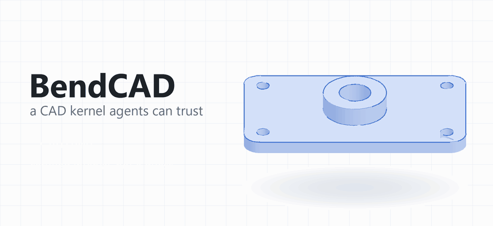

<p align="center"></p>

<h1 align="center">BendCAD</h1>

<p align="center"><b>The CAD kernel AI agents can trust.</b><br>
Open source. Written in <a href="https://github.com/HigherOrderCO/Bend">Bend</a>. Proven where it can be, certified where it must be, honest everywhere else.</p>

<p align="center"><picture><source media="(prefers-color-scheme: dark)" srcset="media/hero_dark.gif"></picture></p>

Every CAD program you have used sits on a geometry kernel: the engine that turns "a plate, four bolt holes and a boss" into an exact solid you can measure, mesh and machine. The kernels in use today are decades-old C++ built for humans clicking buttons. When they fail, they fail quietly, or with an error only an expert can read.

BendCAD is a new kernel built for a different user: an AI agent that has to design real parts alone and know when to believe the answer.

- **Never silently wrong.** Every number says what it is: proven, certified to a bound, estimated, or assumed.
- **Failures explain themselves.** A refused edit names what went wrong, where, why, and how to fix it, and leaves the design untouched.
- **Intent is checked.** Each operation declares what it should do ("remove material, add two faces, make one through-hole"), and the kernel measures the result and rejects a mismatch.
- **Tolerances are native.** Parameters carry tolerance zones, and the kernel reports how answers move inside them.
- **Fast and parallel by law.** Bend spreads work across every core with no threads or locks to manage, and the kernel is written to use it: balanced trees and divide-and-conquer, never a quadratic loop where a fast one exists.

## A taste

This is the bracket in the animation above. An agent (or you) sends these edits to the `bendcad` CLI or its MCP server:

```lisp
(param W 120 119.9 120.1)  (param H 80)  (param T 8)  (param R 10)
(node 1 (prism 0 T (region (path R 0 (line (- W R) 0) (arc (- W R) R R W R ccw)
   (line W (- H R)) (arc (- W R) (- H R) R (- W R) H ccw) (line R H)
   (arc R (- H R) R 0 (- H R) ccw) (line 0 R) (arc R R R R 0 ccw))))
   (intent create 10 0 1 0))
(node 2 (holes 1 (face 1 0 top) through (hole 12 12 4) (hole (- W 12) 12 4)
   (hole 12 (- H 12) 4) (hole (- W 12) (- H 12) 4)) (intent remove 4 2 1 4))
(node 3 (pad 2 (face 1 0 top) 12 (region (circle (/ W 2) (/ H 2) 20))) (intent add 2 1 1 4))
(node 4 (holes 3 (face 3 0 top) through (hole (/ W 2) (/ H 2) 10)) (intent remove 1 2 1 5))
```

Back comes a certified volume interval for every node, durable face names that survive parameter changes, and the sensitivity of the volume to `W`. Change `W` to 140 and only what depends on it rebuilds. Ask for something impossible and you get a structured refusal with a fix, never a broken solid. The full language is in [tools/mcp/language.md](tools/mcp/language.md).

## What works today

- **Sketching and solving:** profiles with lines and arcs, islands and holes, and a constraint solver that reports rank and degrees of freedom.
- **Solids:** boxes, cylinders, cones, spheres, tori, extrusions, revolves, pads, pockets, holes, placement and arbitrary rotation.
- **Freeform geometry:** a B-spline/NURBS library, and `skin` lofts through any number of sections (NACA or free point runs in their own frames), decomposed exactly into bicubic Bezier patch faces with a certified self-intersection check.
- **True booleans:** union, difference and intersection of solids whose boundaries cross, including freeform patch faces. K1 traces and certifies every surface-surface intersection (planes, quadrics, tori, cones and patches), splits faces along the curves, and assembles a B-rep that must pass full embedding (C04) and face/edge (C07) validation before it is committed. Disjoint and separated pieces are proven apart by certified convex-hull subdivision rather than traced.
- **Features:** sweep, loft, chamfer, fillet, draft, offset, shell, and linear and circular patterns.
- **Truth about geometry:** certified curve and surface intersections, inside/outside classification, and embedding and cavity checks. Transformed and traced faces carry measured, certified slack, never a guessed tolerance.
- **Meshes:** a general tessellator for every face kind (seam-safe parameterisation, shared edge samples, one orientation per face, faces in parallel), with display and manufacturing quality presets. Conformity is measured, not assumed (`tools/mesh/check.py`): on freeform patch faces every edge is shared by exactly two triangles, but zero-area slivers remain (see `docs/evaluation-2026-11-11.md`).
- **Queries:** closest points, sections, mass properties, interference and certified clearance, each certified or honestly marked approximate.
- **Interchange:** STEP AP242 per part and per assembly (freeform faces export as `B_SPLINE_SURFACE`), a versioned B-rep archive, and STL/3MF meshes.
- **Viewer:** `bendcad DESIGN scene DIR TITLE NAME NODE R G B SPIN EX EY EZ ...` tessellates an assembly into `DIR`, and `bendcad view PORT DIR` serves the built-in WebGL viewer (`viewer/`) from the kernel itself: orbit, assembled and exploded views, a section cut, and a run mode that spins each part at its own speed ratio, with WebM recording and PNG snapshots.
- **For agents:** the `bendcad` CLI, a cached server front end (`bendcad serve PORT`, repeat commands in about 0.02 s), and an MCP server. In our first challenge, fresh AI agents built and edited a parameterized bracket from a written brief, and an independent grader passed every run.

## How we keep it honest

- **End-to-end journeys first.** Real designs are built, edited, refused and re-measured through the CLI and MCP server, and every run leaves a reproducible report. Geometry and numerics are judged this way, against independent oracles such as OCCT reading our STEP files.
- **Byte identity.** Every speed change must reproduce a fixed battery of real designs bit-for-bit ([tools/speed/ident.py](tools/speed/ident.py)).
- **Laws, honestly counted.** Bend laws are only proofs when they quantify over their inputs and pass Bend's Lean-checked `--verdict`. Most of the kernel's existing laws are fixed-input F64 checks, which we treat as tests rather than proofs. The work now is to move laws onto discrete structure (topology, the operation graph, parsing) where real proofs are possible.
- **Receipts.** Every milestone closes with a dated receipt of exactly what was measured ([docs/receipts](docs/receipts)).

## Where it's going

The goal is a kernel an agent can take from a written brief all the way to a part a machine shop can build, and eventually to a whole machine. The road there is a ladder of graded challenges:

<!-- ladder:begin (generated by tools/readme/ladder.py from docs/receipts) -->
| | Challenge | Status |
|---|---|---|
| G1 | Parameterized mounting bracket with curved edges and holes | ✅ passed: 5/5 runs re-graded PASS (`docs/receipts/g1/rerun-2026-10-27`) |
| G2 | Flanged pump housing: bolt pattern, gasket groove, fits certified over tolerances | ✅ passed: run 1 graded 25/25 by OCCT reading the exported STEP (`docs/receipts/g2/run1`) |
| G3 | Two-stage gearbox: gears, shafts, bearings, housing, seals | ✅ passed: v3 gearbox, every part valid=True, interference pairs 0 (`docs/receipts/g3/v3`) |
| G4 | Centrifugal blower with modal analysis and machining checks | ❌ not passed: run 1 graded 44 pass, 4 fail, 2 deferred of 50 (`docs/receipts/g4/run1`) |
| G5 | A ~100 N micro turbojet, with drawings a shop can build from | in progress: readiness 0/10 pass, 5 fail (`docs/receipts/g5/review/readiness.json`); design point 99.3 N at 118,486 r/min (`cycle.json`) |
| G6 | A bespoke jet engine from a performance brief | not started |
<!-- ladder:end -->

And the kernel milestones that carry it there:

- **Shipped:** professional queries: closest points, sections, mass properties, interference and clearance, each certified or honestly marked approximate.
- **Shipped:** interchange: a versioned B-rep archive, a declared STEP read/write profile validated by independent readers, and STL/3MF mesh exports on CLI and MCP paths.
- **Shipped:** assemblies: mates solved exactly with kinematic degrees of freedom, certified interference and clearance, exploded views, and assembly lineage with durable selectors.
- **Shipped:** semantic PMI and GD&T: dimensions, tolerances and datum reference frames bound to durable selectors, evaluated over envelopes and operating states, exported as STEP AP242.
- **Shipped:** specialized modeling: sheet metal with certified flat patterns, open-shell surface modeling with thickening to solids, and NACA blade sections with ruled stacking and certified section reports.
- **Shipped:** professional release qualification: a stable CLI with structured errors and resource/cancellation gates, a documented SDK boundary, reproducible builds, diagnostics, a versioned corpus, and regression gates every future capability re-runs.
- **Shipped:** rotor analysis (K3): certified mass moments, balance and rotor critical speeds, curved-T10 FEM modes and spin growth, blade-root blends, and machinability verdicts that refuse a slot narrower than the tool.
- **Shipped:** freeform and true booleans (K4): NURBS and Bezier patch solids, certified surface-surface tracing for every face kind, face splitting, and full C04/C07 validation of the result.
- **Shipped:** speed: whole-design work reuse, parallel validation, certified separation proofs, and a 6.4-minute split-parallel kernel build.
- **Now:** the G5 micro turbojet, assembled in the kernel's own viewer and exported as STEP.

The full plan is [MASTER_PLAN.md](MASTER_PLAN.md).

## Try it

BendCAD builds with a pinned build of the Bend language that adds 64-bit integers and floats ([`BEND_PIN`](BEND_PIN) names the exact commit; never track floating `main`). On Linux or WSL:

```sh
bend src/c06/cli.bend -o bendcad.c
python3 tools/build/csplit.py bendcad.c build 32
ls build/tu*.c | xargs -P 10 -I{} cc -O3 -c {} -o {}.o
cc build/tu*.c.o -o bendcad -lpthread -lm
./bendcad bracket.bcd new
./bendcad bracket.bcd apply '(param W 120)' '(node 1 (box W 80 8) (intent create 6 0 1 0))'
./bendcad bracket.bcd eval
```

The kernel compiles to one large C file. Splitting it into translation units and compiling them in parallel brings the build to about 6 to 7 minutes. Code generation needs about 15 GB of memory.

To look at a design, export a scene and serve the viewer:

```sh
mkdir -p viewer/bracket
./bendcad bracket.bcd scene viewer/bracket Bracket bracket 1 0.7 0.72 0.75 0 0 0 0
./bendcad view 8790 viewer
```

Then open `http://127.0.0.1:8790/?scene=bracket/scene.json`. Each part is `NAME NODE R G B SPIN EX EY EZ`: a colour, a speed ratio for run mode, and an explode offset.

To drive it from an agent, point your MCP client at `node tools/mcp/bendcad-mcp.mjs`.

## Contributing

BendCAD is young, ambitious and open. Geometry people, proof people, Bend people and CAD users are all welcome. Read [CONTRIBUTING.md](CONTRIBUTING.md) to get set up and to learn the few rules that keep the kernel trustworthy.

## License

[Apache License 2.0](LICENSE).
