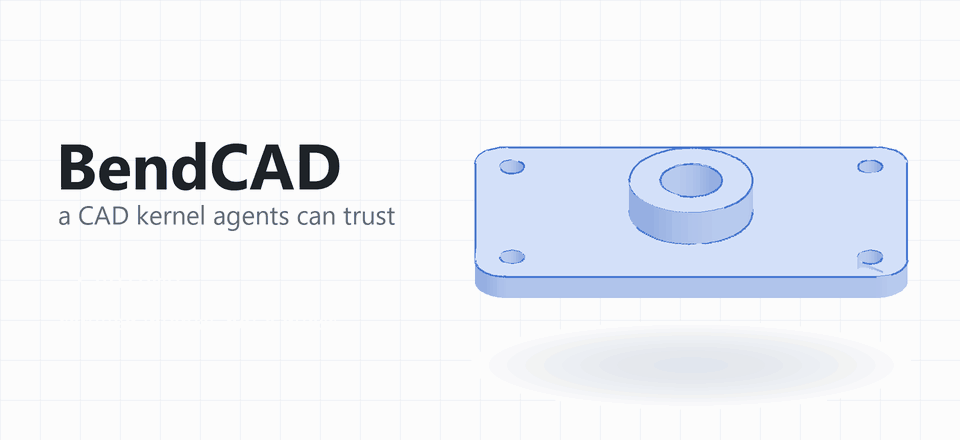

<p align="center"></p>

<h1 align="center">BendCAD</h1>

<p align="center"><b>The CAD kernel AI agents can trust.</b><br>
Open source. Written in <a href="https://github.com/HigherOrderCO/Bend">Bend</a>. Proven where it can be, certified where it must be, honest everywhere else.</p>

<p align="center"><picture><source media="(prefers-color-scheme: dark)" srcset="media/hero_dark.gif"></picture></p>

Every CAD program you have used sits on a geometry kernel: the engine that turns "a plate, four bolt holes and a boss" into an exact solid you can measure, mesh and machine. The kernels in use today are decades-old C++ built for humans clicking buttons. When they fail, they fail quietly, or with an error only an expert can read.

BendCAD is a new kernel built for a different user: an AI agent that has to design real parts alone and know when to believe the answer.

- **Never silently wrong.** Every number says what it is: proven, certified to a bound, estimated, or assumed.
- **Failures explain themselves.** A refused edit names what went wrong, where, why, and how to fix it, and leaves the design untouched.
- **Intent is checked.** Each operation declares what it should do ("remove material, add two faces, make one through-hole"), and the kernel measures the result and rejects a mismatch.
- **Tolerances are native.** Parameters carry tolerance zones, and the kernel reports how answers move inside them.
- **Fast and parallel by law.** Bend spreads work across every core with no threads or locks to manage, and the kernel is written to use it: balanced trees and divide-and-conquer, never a quadratic loop where a fast one exists.

## A taste

This is the bracket in the animation above. An agent (or you) sends these edits to the `bendcad` CLI or its MCP server:

```lisp
(param W 120 119.9 120.1)  (param H 80)  (param T 8)  (param R 10)
(node 1 (prism 0 T (region (path R 0 (line (- W R) 0) (arc (- W R) R R W R ccw)
   (line W (- H R)) (arc (- W R) (- H R) R (- W R) H ccw) (line R H)
   (arc R (- H R) R 0 (- H R) ccw) (line 0 R) (arc R R R R 0 ccw))))
   (intent create 10 0 1 0))
(node 2 (holes 1 (face 1 0 top) through (hole 12 12 4) (hole (- W 12) 12 4)
   (hole 12 (- H 12) 4) (hole (- W 12) (- H 12) 4)) (intent remove 4 2 1 4))
(node 3 (pad 2 (face 1 0 top) 12 (region (circle (/ W 2) (/ H 2) 20))) (intent add 2 1 1 4))
(node 4 (holes 3 (face 3 0 top) through (hole (/ W 2) (/ H 2) 10)) (intent remove 1 2 1 5))
```

Back comes a certified volume interval for every node, durable face names that survive parameter changes, and the sensitivity of the volume to `W`. Change `W` to 140 and only what depends on it rebuilds. Ask for something impossible and you get a structured refusal with a fix, never a broken solid. The full language is in [tools/mcp/language.md](tools/mcp/language.md).

## What works today

- **Sketching and solving:** profiles with lines and arcs, islands and holes, and a constraint solver that reports rank and degrees of freedom.
- **Solids:** boxes, cylinders, cones, spheres, tori, extrusions, revolves, pads, pockets, holes, placement and rotation.
- **Booleans:** union, difference and intersection of solids whose boundaries don't cross. Crossing boundaries are refused by name until face splitting lands.
- **Features:** sweep, loft, chamfer, fillet, draft, offset, shell, and linear and circular patterns.
- **Truth about geometry:** certified curve and surface intersections, inside/outside classification, and embedding and cavity checks.
- **Meshes:** display and manufacturing tessellation with stated chord and angle quality and a triangle budget.
- **Queries:** closest points, sections, mass properties, interference and clearance, each certified or honestly marked approximate.
- **For agents:** the `bendcad` CLI and an MCP server. In our first challenge, fresh AI agents built and edited a parameterized bracket from a written brief, and an independent grader passed every run.

## How we keep it honest

- **Laws, not just tests.** 295 properties are stated for *every* input and proven by Bend's checker and again by a Lean-proven kernel. Each family of laws is shown to catch a deliberately planted bug.
- **Pins.** 1,970 fixed-input checks run as compiled code and are compared bit-for-bit.
- **End-to-end journeys.** Real designs are built, edited, refused and re-measured through the CLI and MCP server, and every run leaves a reproducible report.
- **Receipts.** Every milestone closes with a dated receipt of exactly what was measured ([docs/receipts](docs/receipts)).

## Where it's going

The goal is a kernel an agent can take from a written brief all the way to a part a machine shop can build, and eventually to a whole machine. The road there is a ladder of graded challenges:

| | Challenge | Status |
|---|---|---|
| G1 | Parameterized mounting bracket with curved edges and holes | ✅ passed |
| G2 | Flanged pump housing: bolt pattern, gasket groove, fits certified over tolerances | next |
| G3 | Two-stage gearbox: gears, shafts, bearings, housing, seals | planned |
| G4 | Centrifugal blower with modal analysis and machining checks | planned |
| G5 | A ~100 N micro turbojet, with drawings a shop can build from | planned |
| G6 | A bespoke jet engine from a performance brief | the summit |

And the kernel milestones that carry it there:

- **Shipped:** professional queries: closest points, sections, mass properties, interference and clearance, each certified or honestly marked approximate.
- **Shipped:** interchange: a versioned B-rep archive, a declared STEP read/write profile validated by independent readers, and STL/3MF mesh exports on CLI and MCP paths.
- **Now:** specialized modeling, then assemblies with mates and kinematics, then tolerances and GD&T bound to geometry.
- **Then:** sheet metal, surface modeling, and blade and airfoil design, followed by a qualified public release.

The full plan is [MASTER_PLAN.md](MASTER_PLAN.md).

## Try it

BendCAD builds with a pinned build of the Bend language that adds 64-bit integers and floats ([`BEND_PIN`](BEND_PIN) names the exact commit; never track floating `main`). On Linux or WSL:

```sh
bend src/c06/cli.bend -o bendcad
./bendcad bracket.bcd apply '(param W 120)' '(node 1 (box W 80 8) (intent create 6 0 1 0))'
./bendcad bracket.bcd eval
```

To drive it from an agent, point your MCP client at `node tools/mcp/bendcad-mcp.mjs`.

## Contributing

BendCAD is young, ambitious and open. Geometry people, proof people, Bend people and CAD users are all welcome. Read [CONTRIBUTING.md](CONTRIBUTING.md) to get set up and to learn the few rules that keep the kernel trustworthy.

## License

[Apache License 2.0](LICENSE).
